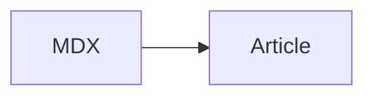

## MDX content

<aside aria-label="An MDX example">This is a local verification fixture.</aside>

[[attachment:22222222-2222-4222-8222-222222222222]]

Inline math also works here: $a^2 + b^2 = c^2$.

