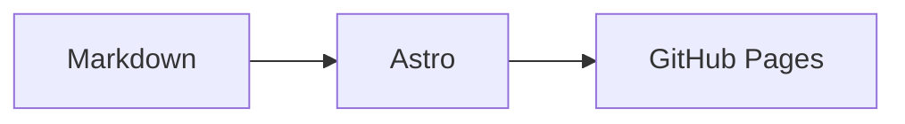

## Code with syntax highlighting

```swift
struct Notebook {
    let title: String
    func write() async -> String { "An intentionally long code example that should scroll inside its own block on a small phone without making the entire page overflow." }
}
```

[[attachment:11111111-1111-4111-8111-111111111111]]

## A diagram



## Math

An inline expression: $E = mc^2$.

$$
\sum_{i=1}^{n} i = \frac{n(n+1)}{2}
$$
